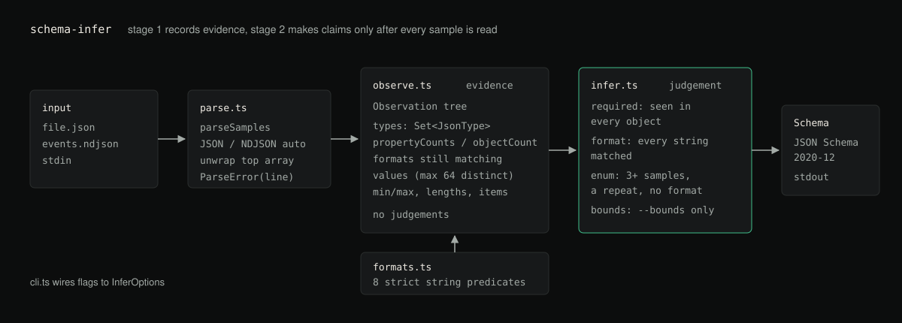

# schema-infer

Infer a JSON Schema 2020-12 document from sample JSON or NDJSON, claiming only
what the samples support.

[](https://github.com/hellpuffyt/schema-infer/actions/workflows/ci.yml)
[](LICENSE)



**Status:** version 0.1.0. Library and CLI work and are tested on Node 20 and
22; the package is not on the npm registry yet, so install from a clone.

## What it does

Point it at real data and it writes the schema you would otherwise write by
hand. The CLI prints with a 2-space indent; the output below is condensed to
save space.

```console
$ cat orders.ndjson
{"id":"550e8400-e29b-41d4-a716-446655440000","email":"a@b.com","status":"paid","total":19.99,"tags":["x"]}
{"id":"650e8400-e29b-41d4-a716-446655440000","email":"c@d.com","status":"pending","total":5,"tags":[]}
{"id":"750e8400-e29b-41d4-a716-446655440000","email":"e@f.com","status":"paid","total":42.5,"note":"gift"}

$ schema-infer --enum 5 orders.ndjson
{
  "$schema": "https://json-schema.org/draft/2020-12/schema",
  "type": "object",
  "properties": {
    "email":  { "type": "string", "format": "email" },
    "id":     { "type": "string", "format": "uuid" },
    "note":   { "type": "string" },
    "status": { "enum": ["paid", "pending"] },
    "tags":   { "type": "array", "items": { "type": "string" } },
    "total":  { "type": "number" }
  },
  "required": ["email", "id", "status", "total"]
}
```

Without any hints, `note` and `tags` are optional because
some records lacked them, `total` widened to `number` because `5` and `42.5` were both present,
`status` became an enum but `id` and `email` did not, and `tags` kept its item
type even though one sample was an empty array.

## Why

Writing a JSON Schema for an API you did not design is tedious and error-prone.
Most generators make it worse by trusting a small sample: they will tell you a
field is an enum of two values because your sample had two rows, or that a
string is `format: email` because the first one looked like an address.

A schema that is wrong in that direction rejects valid production data. This
tool takes the opposite bias and **claims only what the evidence supports**:

- A `format` survives only while **every** observed string matches it. One
  counter-example withdraws the claim.
- `required` means a key was present in **every** object seen at that position.
- An `enum` needs `--enum <n>`, three or more samples, a repeated value, and no
  surviving string format, so identifiers and timestamps never become closed
  sets.
- `minimum`/`maxLength`/`minItems` are **off by default**, because observed
  bounds describe your sample, not your data model.

## Features

- **JSON and NDJSON**, auto-detected. Pretty-printed multi-line JSON is
  correctly *not* treated as NDJSON.
- **Type unions** in canonical order, so output is byte-stable regardless of
  input order.
- **`integer` vs `number`**, collapsing to `number` when both appear.
- **Eight string formats**: `date-time`, `date`, `time`, `uuid`, `email`,
  `ipv4`, `ipv6`, `uri`, checked strictly (real calendar dates, RFC 3339
  times with the offset JSON Schema requires, a real IPv6 parser), so every
  sample validates against the schema it produced. `tests/validator.test.ts`
  checks this with ajv's JSON Schema 2020-12 validator.
- **Optionality** derived from presence counts across all samples.
- **Recursive** through nested objects and arrays, merging element evidence
  across separate arrays.
- **Library and CLI**, typed, no runtime dependencies.

## Architecture

Inference runs in two stages, and the rest of the design follows from that:

```
samples ──▶ observe.ts ──▶ Observation tree ──▶ infer.ts ──▶ Schema
              (evidence)                          (judgement)
```

`observe.ts` folds every sample into a tree that records *what was seen*: type
counts, per-key presence counts, surviving format candidates, observed bounds.
`infer.ts` then converts that tree into a schema in one pass.

They are separate because optionality cannot be decided until all samples have
been read. A generator that builds the schema incrementally has to keep
rewriting `required` as it goes, and that is where such tools usually get it
wrong.

| Module | Responsibility |
| --- | --- |
| `observe.ts` | Accumulate evidence. No judgements. |
| `infer.ts` | Turn evidence into a schema. No I/O. |
| `formats.ts` | Format patterns and priority. Pure predicates. |
| `parse.ts` | Read JSON/NDJSON text into samples. |
| `cli.ts` | Argument parsing and wiring. |

## Installation

schema-infer is not published to the npm registry yet (`npm install
schema-infer` finds nothing). Install it from a clone:

```bash
git clone https://github.com/hellpuffyt/schema-infer
cd schema-infer
npm ci && npm run build
npm link                      # puts `schema-infer` on your PATH
```

Requires Node 20 or newer.

## Usage

### CLI

```bash
schema-infer data.json                     # a single document
schema-infer events.ndjson                 # one document per line
cat data.json | schema-infer               # stdin
schema-infer a.ndjson b.ndjson             # merge several files
schema-infer --enum 8 --closed data.json   # enums plus additionalProperties:false
schema-infer --bounds data.json            # include observed min/max
schema-infer --title User data.json        # add a title
```

| Option | Description |
| --- | --- |
| `-f`, `--format <json\|ndjson\|auto>` | How to read the input (default `auto`) |
| `-t`, `--title <text>` | Set the schema title |
| `-d`, `--description <text>` | Set the schema description |
| `--enum <n>` | Collapse to `enum` at ≤ n distinct values |
| `--bounds` | Emit `minimum`/`maximum`, `minLength`/`maxLength`, `minItems`/`maxItems` |
| `--closed` | Set `additionalProperties: false` |
| `--no-formats` | Disable string format detection |
| `--no-dialect` | Omit the `$schema` keyword |
| `--no-unwrap` | Treat a top-level array as one sample, not many |
| `-i`, `--indent <n>` | Output indent (default `2`) |
| `-h`, `--help` | Show help |
| `-v`, `--version` | Show the version |

Exit codes: `0` success, `1` error, `2` usage error.

### Library

```ts
import { inferSchema } from 'schema-infer';

const schema = inferSchema([
  { id: 1, name: 'Ada' },
  { id: 2 },
]);
// → properties id and name; required: ['id']
```

```ts
import { inferSchema, parseSamples } from 'schema-infer';
import { readFileSync } from 'node:fs';

const samples = parseSamples(readFileSync('events.ndjson', 'utf8'));
const schema = inferSchema(samples, { enumThreshold: 8, closedObjects: true });
```

## API

### `inferSchema(samples: JsonValue[], options?: InferOptions): Schema`

Infers a schema from many samples. Each sample is treated as a separate document
**at the same position**, so passing an array of records infers the schema *of
a record*. To describe the array itself, use `inferSchemaFromValue`.

### `inferSchemaFromValue(sample: JsonValue, options?: InferOptions): Schema`

Infers a schema describing one value, arrays included.

### `InferOptions`

| Option | Type | Default | Meaning |
| --- | --- | --- | --- |
| `detectFormats` | `boolean` | `true` | Emit `format` when every sample agrees |
| `enumThreshold` | `number` | `0` | Collapse to `enum` at ≤ n distinct values; `0` disables |
| `inferBounds` | `boolean` | `false` | Emit observed numeric/length/item bounds |
| `closedObjects` | `boolean` | `false` | Set `additionalProperties: false` |
| `dialect` | `string \| null` | 2020-12 | `$schema` value; `null` omits it |

### `parseSamples(text, format?, unwrapArray?): JsonValue[]`

Parses JSON or NDJSON. Throws `ParseError`, which carries the offending `line`
for NDJSON input.

## Examples

**Optionality is evidence-based.** A key present in some records but not others
is inferred, but not required:

```ts
inferSchema([{ a: 1, b: 2 }, { a: 3 }], { dialect: null });
// { type: 'object', properties: { a: {...}, b: {...} }, required: ['a'] }
```

**Formats are withdrawn on contradiction:**

```ts
inferSchema(['a@b.com'], { dialect: null });               // format: 'email'
inferSchema(['a@b.com', 'nope'], { dialect: null });       // no format
```

**Enums need a closed set, not a small sample:**

```ts
inferSchema(['red', 'green'], { enumThreshold: 5 });               // no enum: only 2 samples
inferSchema(['a', 'b', 'c', 'd'], { enumThreshold: 9 });           // no enum: all distinct
inferSchema(['on', 'off', 'on', 'off'], { enumThreshold: 5 });     // enum: ['off', 'on']
```

## Configuration

There is no config file. Every knob is a flag or an option object, so a result
is always reproducible from the invocation alone.

## Testing

```bash
npm test          # 89 tests
npm run coverage
npm run lint
npm run typecheck
npm run build
```

CI runs the suite on Node 20 and 22 across Linux, macOS and Windows, a job that
runs lint, typecheck, build and coverage on Node 22, and a smoke job that
executes the built CLI, since a build that type-checks can still fail to run.

## Deployment

Publishing to npm (not done yet; for the maintainer):

```bash
npm run build
npm publish
```

`prepublishOnly` runs the build, and `files` limits the published tarball to
`dist`, the README, the licence and the changelog.

## Security

- **No runtime dependencies**, so the install surface is this package alone.
- **No network access and no `eval`.** Input is parsed with `JSON.parse`.
- Inference is **memory-bounded**: distinct-value tracking stops at 64 values
  per position, so a large or hostile file cannot make it retain everything.
- The tool reads data you point it at and writes a schema to stdout. It never
  writes to your input files.
- Deeply nested input that would exhaust the call stack is reported as an
  error, not a crash. Report vulnerabilities privately as described in
  [SECURITY.md](SECURITY.md).

## Contributing

See [CONTRIBUTING.md](CONTRIBUTING.md) for setup and the checks CI runs.
[CHANGELOG.md](CHANGELOG.md) lists changes, and
[docs/PRODUCTION_READINESS.md](docs/PRODUCTION_READINESS.md) records the last
audit.

## Roadmap

Not implemented yet:

- `$defs` extraction for structures repeated across the tree.
- `oneOf` for tagged unions detected by a discriminator key.
- Merging into an existing schema rather than always generating fresh.

## License

MIT, see [LICENSE](LICENSE).
